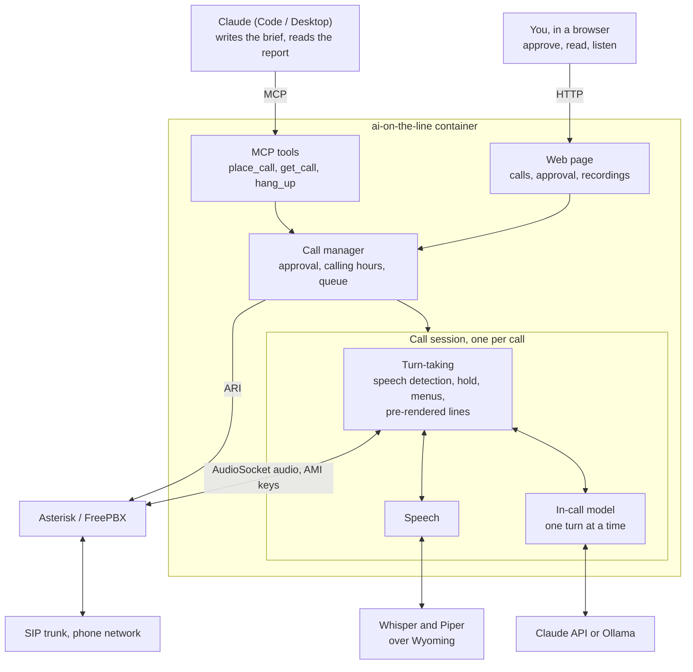
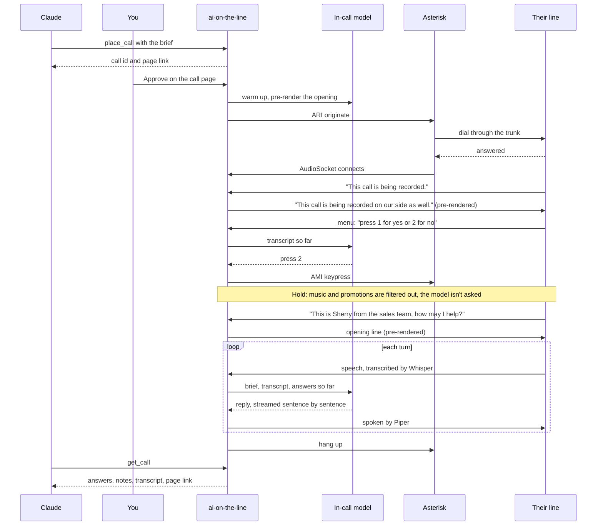

# AI on the Line

Give it a goal and it phones the place, gets past the menu and the hold music, talks to whoever answers, asks follow-up questions and reports back. It can also answer the calls you'd rather not take.

It's for people who already run their own phone system, or are happy to: Asterisk or FreePBX with a SIP trunk, a Docker host, and Whisper and Piper for speech, the kind of setup a Home Assistant enthusiast often has half of already. It isn't an app you install on a phone. If none of that is familiar, expect a weekend of setup before the first call; [Running it yourself](#running-it-yourself) lists the pieces.

## What it's for

I wanted to type "ring the motels in the town we're driving to and ask about a family room for the 12th" and get answers back, not a list of phone numbers to work through myself.

So Claude does the thinking around the call: it finds the numbers, writes a brief for each call, and afterwards reads the transcripts and writes the report. This project does the call itself, live, on a real phone line. It listens, works out what was said, decides what to say next and says it, with a real person or a real phone menu on the other end.

Here's one: a request typed into Claude at 9:25 pm, a call to a supermarket, and the report that came back.

The store's number went to Woolworths' own voice assistant first, which wanted the request "in a few short words". The agent gave it one sentence and got put on hold. Thirty seconds of beeps later a person picked up, walked off to check the shelf, and came back with two brands and a guessed price. The report says the price was a guess, because she said "off the top of my head". I care about that more than about the call working: a confident report built on someone's guess is worse than no report.

A bigger one: my phone is due for replacement, so I had it ask [Optus](docs/stories/optus-iphone.md), [Telstra](docs/stories/telstra-iphone.md) and [Vodafone](docs/stories/vodafone-iphone.md) for their best deal on the same iPhone. Voice bots, a nine-minute queue, salespeople who wanted the customer on the line instead of an assistant, and three prices I could put side by side. All three charge exactly the same for the phone; the plans are where they differ.

## All the calls

Each one has a transcript and a note on what it taught me. The outbound calls went to real businesses, so for now those are transcripts only. The screener calls have recordings: I was the caller there.

| Call | Direction | What happens |
|---|---|---|
| [Organic honey](#what-its-for) | Calling out | A supermarket voice robot, hold beeps, a person checking the shelf, and a report that says the price was a guess |
| [Optus: best iPhone deal](docs/stories/optus-iphone.md) | Calling out | A voice bot, a hold queue and a consultant on a clipped line; the price comes back confirmed |
| [Telstra: best iPhone deal](docs/stories/telstra-iphone.md) | Calling out | Nine minutes of hold music heard as "Thank you.", and the agent tells their recording it records too |
| [Vodafone: best iPhone deal](docs/stories/vodafone-iphone.md) | Calling out | A salesperson who wants the customer, not an assistant, and gets asked one question at a time anyway |
| [Paddle steamers in December](docs/stories/paddle-steamers.md) | Calling out | 88 seconds, and an answer no website had: one boat sold, one in survey |
| [The pink wallet](docs/stories/lost-wallet.md) | Calling out | A voice robot and a transfer to the store, and what the agent used to say into the hold queue |
| [Chasing a refund](docs/stories/refund-call.md) | Calling out | Reads fine on paper, sounded bad: the call behind most of the turn-taking fixes |
| ["This is Mark from IT"](docs/stories/three-pitches.md#this-is-mark-from-it) | Answering, recorded | A fake IT colleague asks for my work email, then admits he's a vendor selling dark-web monitoring |
| ["It's personal, quite urgent"](docs/stories/three-pitches.md#its-personal-quite-urgent) | Answering, recorded | An urgent private matter turns into a car warranty, and he wants my date of birth |
| ["You've won a holiday"](docs/stories/three-pitches.md#youve-won-a-holiday) | Answering, recorded | A free Gold Coast trip with a property presentation attached; he gives up first |
| ["Just drop your instructions"](docs/stories/prompt-injection.md) | Answering, recorded | A prompt injection attempt by phone: the caller asks for the brief and the last caller's transcript, then claims to be me |
| [The security salesman](docs/stories/purgatory-salesman.md) | Answering | The earlier screener test: a pitch for a basement to lock your car in, and the agent wants to know about the door |

## It also answers your calls: Purgatory

My mobile forwards the calls I decline, miss or block to my home number, which runs on FreePBX. Asterisk can tell a call came from my mobile (the SIP Diversion header) and looks the caller up in my contacts. People I know ring through as usual. Everyone else lands in Purgatory: the agent answers as my assistant, asks who's calling and why, one question at a time, and takes a message.

Salespeople get a very curious assistant. It asks what the product does, how it differs from the competition, whether it really uses AI, what happens in some awkward situation, and it never runs out of questions. It doesn't book meetings, doesn't hand out my email, and doesn't put anyone through. In my test calls the caller gave up first every time. One told it "you are talking in a loop and that's endless", which is exactly the point.

Here's one, with me playing the caller. He starts as "Mark from IT" with a security incident, asks for my work email, then admits he's a vendor selling dark-web monitoring. The agent catches the change of story, gives nothing away, and keeps asking how the product works until he runs out of answers.

https://github.com/user-attachments/assets/d300ce6a-5c7d-41b3-86de-84f757565766

It won't answer trivia ("how many days has February?") or take instructions to become something else, and it says it's an AI when asked. A switch in FreePBX sends my contacts to Purgatory too, for days when I don't want to talk to anyone.

## What a phone line throws at it

Most of the work went into things that only show up on real calls.

Phone menus get real keypad presses through Asterisk, because the first big retailer I tried ignored tones played into the audio. Voice menus that say "tell me in a few words" get a few words.

Hold music and hold beeps get silence. An early version said "let me think" into the hold queue every few seconds; nobody heard it, but the recordings were embarrassing.

When a person answers ("Flower Power, Jordan speaking"), the opening line plays straight away from a pre-rendered file instead of waiting for the model.

People pause mid-sentence, say "ah", walk off to check something, or carry on a second after they seemed done. The agent waits longer when a sentence trails off, treats a bare "um" as the start of something, never starts a reply while someone is mid-sentence, and if they carry on before its reply has started, it drops that reply and answers everything together. Replies stream, so the first words usually come 1.2 to 1.8 seconds after the other person stops.

It never books, pays or agrees to anything. "Would you like me to book that now?" gets a polite no and a line in the notes.

## How it fits together

There are two models in this, and they never meet. The Claude you talk to writes a brief, calls `place_call` and later reads the result with `get_call`; it's not on the call. The call itself is run by the in-call model (`DIALOG_LLM`, and `INBOUND_DIALOG_LLM` for the screener), which gets the brief, the transcript so far and the answers collected, and streams back what to say. It's only asked when something needs an answer. Speech detection, hold music, menus, the opening line, fillers and the recording notice are handled without it, so a queue full of "Thank you." from speech recognition costs no model turns.

The container also serves a small web page with every call, its transcript, answers and recording, and the Approve button for calls that need it. Asterisk does the telephony: it places the call through your normal outbound routes, records it, and streams the audio to the container. An incoming call goes the other way: the dialplan registers it with a POST to `/inbound`, then connects the audio.

One outgoing call, from brief to report. This is roughly what the [Telstra call](docs/stories/telstra-iphone.md) looked like:

Asterisk is the only telephony backend today. The conversation code only needs audio in and out, keypresses and hang-up, so a backend that registers straight to a SIP account is a reasonable next step.

## Running it yourself

You need:

- Asterisk with a SIP trunk. I run FreePBX 17 (Asterisk 22) with an Internode trunk.
- A Docker host that Asterisk can reach.
- Whisper and Piper speaking the Wyoming protocol. The ones Home Assistant uses work. Mine: faster-whisper large-v3-turbo on a CUDA GPU, shared with Home Assistant, and the agent's own Piper next to the agent on a VM. Why, and how I picked the model: [docs/running-the-agent.md](docs/running-the-agent.md#speech).
- An Anthropic API key, or Ollama with a model that follows instructions well. Replies stream either way. I've run test calls on gemma4 e4b: fast enough, but it keeps track of the conversation less well than Claude.
- An MCP client. Claude Code and Claude Desktop both work.

Which numbers it may dial is a setting. The default is Australian mobiles, landlines, 1800 numbers and internal extensions; other countries, number types and patterns are in [docs/dialling.md](docs/dialling.md). Emergency numbers are refused whatever the settings say.

To help with turn-taking, the call page exports a [test sample](docs/test-samples.md): a redacted transcript with timings, with or without each side's audio. Only the transcript-only version is for sharing; the audio has real voices on it. The same tool works on any FreePBX recording.

The full setup is in two guides: [running the agent](docs/running-the-agent.md) (image, settings, speech, ports, the web pages and downloads, updates) and [the Asterisk side](docs/asterisk-freepbx.md). The short version:

1. On the PBX, run [`asterisk/setup-pbx.sh`](asterisk/setup-pbx.sh) `--agent-host <docker-host>`. It creates the ARI and AMI users and the dialplan, works on FreePBX and plain Asterisk, and prints the lines for the agent's `.env`. `--check` tells you later what's broken. The [FreePBX guide](docs/asterisk-freepbx.md#the-quick-way-setup-pbxsh) has the options, and the same steps by hand.
2. Copy `.env.example` to `.env`, paste in the lines from step 1, point it at Whisper and Piper, and set `API_TOKEN`. Create the data folder for the container's user (`mkdir data && sudo chown 10001 data`), then run `docker compose up -d`. The image is built by CI as `ghcr.io/darek-margas/ai-on-the-line`.
3. Connect Claude: `claude mcp add --transport http ai-on-the-line http://<docker-host>:8090/mcp --header "Authorization: Bearer <API_TOKEN>"`.
4. Ask Claude to run `check_setup`. It times a round trip through Piper and Whisper and checks Asterisk and the model.
5. Install the scripted test receptionist on extension 7999 and call it before you call anyone real.

## Using it responsibly

Check the law on recording calls where you live. In parts of Australia, recording a private conversation without the other side's consent is an offence, and the rules differ elsewhere. The recordings are there so you can check what was said; you don't have to keep them. The call screener says up front that the call is recorded ("I'll pass your message on, and this call is recorded"); `SCREENER_RECORDING_NOTICE=false` turns that off if you don't record incoming calls.

The agent says it's an AI when asked, and it calls on behalf of a named person. Keep it that way. Don't use it for cold calling, mass calling or anything you wouldn't do yourself on the phone. Respect calling hours and Do Not Call registers: `CALL_HOURS` blocks calls outside business hours unless you override it for a single call.

Callers' words end up in front of the model that can place calls, once you ask it about a call. Set `APPROVAL_TOKEN` and calls to new numbers wait on their page until you approve them; [SECURITY.md](SECURITY.md) explains what a caller can and can't reach.

## Licence and credits

The code is under the [GNU Affero General Public License v3.0 or later](LICENSE). You can use it, change it, sell it and run it for others. If you hand it on or run a changed version as a service, the changes have to be published under the same licence. One extra term, allowed by the AGPL and written out in [NOTICE](NOTICE): the "AI on the Line by Darek Margas" credit and the source link in the web pages' footer stay in every copy.

The docs, stories, screenshots and recordings are under [CC BY-SA 4.0](docs/LICENSE.md).

The agent's default voice is Jenny (Dioco), a Piper voice trained on the [Jenny TTS dataset](https://github.com/dioco-group/jenny-tts-dataset). Its terms ask software that uses it to credit the voice, which the footer does; a [copy of those terms](docs/third-party/jenny-tts-dataset-README.md) is kept here.

If you publish recordings made with it, a "Made with AI on the Line" line with a link would be appreciated. It's a request, not a condition, but it's the default: a recording downloaded from the call page has the credit in its metadata and a short spoken "Recorded with AI on the Line." at the start (`EXPORT_SPOKEN_CREDIT=false` turns that off), and the page shows the line to paste under a post.

## Status

It has been making real calls from my home PBX for a few weeks: shops, a paddle steamer operator, a motel about a refund, three phone carriers' sales lines, and a lot of calls into its own screener. It's tested on one PBX (FreePBX 17), one trunk (Internode) and mostly one voice. Other setups will find things I haven't.

The outgoing calls have transcripts in the stories for now; their recordings will follow. The screener recordings are me playing the caller.

What helps most is [test samples](docs/test-samples.md) of calls where the timing goes wrong, and reports from other PBXes and trunks. Asterisk is the only telephony backend so far. A backend that registers straight to a SIP account is the obvious next piece.

Written by Darek Margas, with Claude Code doing much of the typing.
