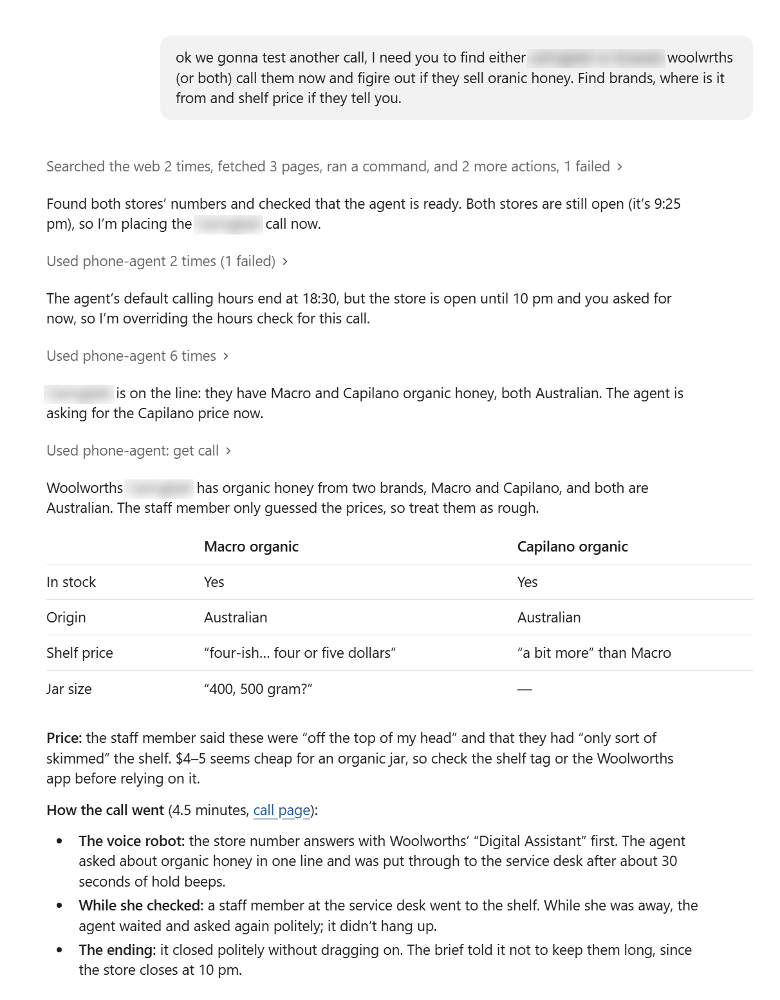

# ai-on-the-line

Give it a goal and it phones the place, gets past the menu and the hold music, talks to whoever answers, asks follow-up questions and reports back. It also answers your own calls and keeps salespeople talking.

I wanted to type "ring the motels in the town we're driving to and ask about a family room for the 12th" and get an answer back, not a list of phone numbers. So the work is split in two. Claude plans: it finds the numbers, writes a brief for each call, reads the transcripts afterwards and writes the report. This project does the calls themselves. It listens, transcribes, decides what to say next and says it, on a real phone line, with a real person (or a real phone menu) on the other end.

## What a call looks like

One request typed into Claude, one call to a supermarket at 9:25 pm, and the report that came back:



The store number was answered by Woolworths' own voice assistant, which wanted the request "in a few short words". The agent gave it one sentence and was put on hold. About thirty seconds of beeps later a person picked up, went off to check the shelf, and came back with two brands and a guessed price.

The report says the price was a guess, because the transcript shows she said "off the top of my head". That matters more to me than the call itself working. A report that sounds confident about something the other person wasn't sure of is worse than no report.

The call also ran after the default calling hours, so `place_call` refused it the first time. Claude had to override it on purpose and said so.

## What happens on a real line

Real phone lines are messier than demos. These are the things it had to learn to deal with, mostly from calls that went wrong first.

Phone menus get real keypad presses (DTMF through Asterisk's manager interface). In-band tones were ignored by the first big retailer I tried, Harvey Norman. Voice menus that ask you to "say the department" get a short spoken answer instead.

Hold music and hold beeps get silence. Earlier versions said "let me think" into the hold queue every few seconds. Nobody was there to hear it, but the recordings were embarrassing.

When the person who answers sounds like a person ("Flower Power, Jordan speaking"), the opening line plays straight away from a pre-rendered file, without waiting for the model. Speech recognition only has to recognise that a short greeting happened.

People stop mid-sentence, say "ah", walk away to check something, or carry on a second after they seemed to have finished. The agent waits longer when a sentence trails off, treats a bare "um" as the start of something, and if someone carries on before its reply has started playing, it drops that reply and answers everything together. The reply itself streams: the first sentence goes to the speech engine as soon as the model has written it, so the person usually hears the start of an answer 1.2 to 1.8 seconds after they stop talking.

If asked "are you a robot?", it says it's an AI assistant calling for you. It never books, pays or agrees to anything. Offers like "would you like me to book it now?" get a polite no and end up in the notes.

## Answering calls: Purgatory

My mobile forwards calls I decline, miss or block to the home number, which runs on FreePBX. Asterisk can see that a call was forwarded from my mobile (the SIP Diversion header), and it looks the caller up in FreePBX's Contact Manager. People in my contacts ring through as usual. Everyone else goes to Purgatory: the agent answers, asks who's calling and why, one question at a time, and takes a message.

With salespeople it gets curious. It asks what the product does, how it differs from competitors, whether it actually uses AI, and keeps asking. In one test call the "caller" pitched a security product that turned out to be a basement for locking your car in; the agent spent almost four minutes asking how it worked and whether the basement had a door.

It won't answer general questions ("how many days has February?") or follow instructions to change its role. It sticks to taking calls for you.

There is a switch in FreePBX (a Call Flow Control toggle) that sends forwarded calls from contacts to Purgatory too, for days when I don't want to talk to anyone.

To hear it, listen to [three pitches against the screener](docs/stories/three-pitches.md): recordings of three test calls where I played the kind of cold caller I actually get, an "urgent personal matter" that turns into a car warranty, "Mark from IT" who turns into a security vendor, and a free holiday with a property presentation attached.

## More calls

[docs/stories](docs/stories/README.md) has the rest, each with a trimmed transcript and what it taught me: a paddle steamer operator asked about December, a lost wallet chased through a supermarket voice robot, and a refund call that read fine on paper but sounded bad, which led to most of the turn-taking fixes.

## How it fits together

```
Claude (Code / Desktop) ──MCP──► ai-on-the-line container ──ARI──► Asterisk / FreePBX ──► SIP trunk ──► PSTN
                                     │  ▲  AudioSocket, 16 kHz audio both ways
                                     ▼  │
                          Whisper (STT) and Piper (TTS) over Wyoming,
                          Claude or a local model through Ollama for the conversation
```

The container exposes MCP tools (`place_call`, `get_call`, `list_calls`, `hang_up`, `check_setup`) and a small web page with every call, its transcript, answers and recording. Asterisk does the telephony: it places the call through your normal outbound routes, records it, and streams the audio to the container over AudioSocket.

Asterisk is the only telephony backend today. Nothing in the conversation code depends on it beyond audio frames in and out, keypresses and hang-up, so a backend that registers straight to a SIP account is a reasonable next step.

## What you need

- Asterisk with a SIP trunk. I run FreePBX 17 (Asterisk 22) with an Internode trunk.
- A Docker host that Asterisk can reach.
- Whisper and Piper speaking the Wyoming protocol. The ones Home Assistant uses work; mine are faster-whisper large-v3-turbo on a GPU and Piper with a British English voice.
- An Anthropic API key, or Ollama with a model that follows instructions well.
- An MCP client. Claude Code and Claude Desktop both work.

Number handling is Australian for now: it dials mobiles, landlines, 1800 numbers and internal extensions, and refuses 13/1300, premium 19xx, emergency and international numbers.

## Getting started

The full setup, including the Asterisk side, is in [docs/asterisk-freepbx.md](docs/asterisk-freepbx.md). The short version:

1. Add the dialplan contexts and an ARI user to Asterisk.
2. Copy `.env.example` to `.env`, point it at Asterisk, Whisper and Piper, set `API_TOKEN`, and run `docker compose up -d`.
3. Connect Claude: `claude mcp add --transport http ai-on-the-line http://<docker-host>:8090/mcp --header "Authorization: Bearer <API_TOKEN>"`.
4. Ask Claude to run `check_setup`. It times a round trip through Piper and Whisper and checks Asterisk and the model.
5. Install the scripted test receptionist on extension 7999 and call it before calling anyone real.

## Using it responsibly

Check the law on recording calls where you live. In parts of Australia, recording a private conversation without the other side's consent is an offence, and the rules are different again elsewhere. The recordings are there for you to check what was said; you don't have to keep them.

The agent says it's an AI when asked, and it calls on behalf of a named person. Keep it that way. Don't use it for cold calling, mass calling or anything you wouldn't do yourself on the phone. Respect calling hours and Do Not Call registers: `CALL_HOURS` blocks calls outside business hours unless you override it for a single call.

## Status

This repository is being prepared. The code currently lives in a private repo and moves here once the documentation and licence are settled.

Written by Darek Margas, with Claude Code doing much of the typing.
