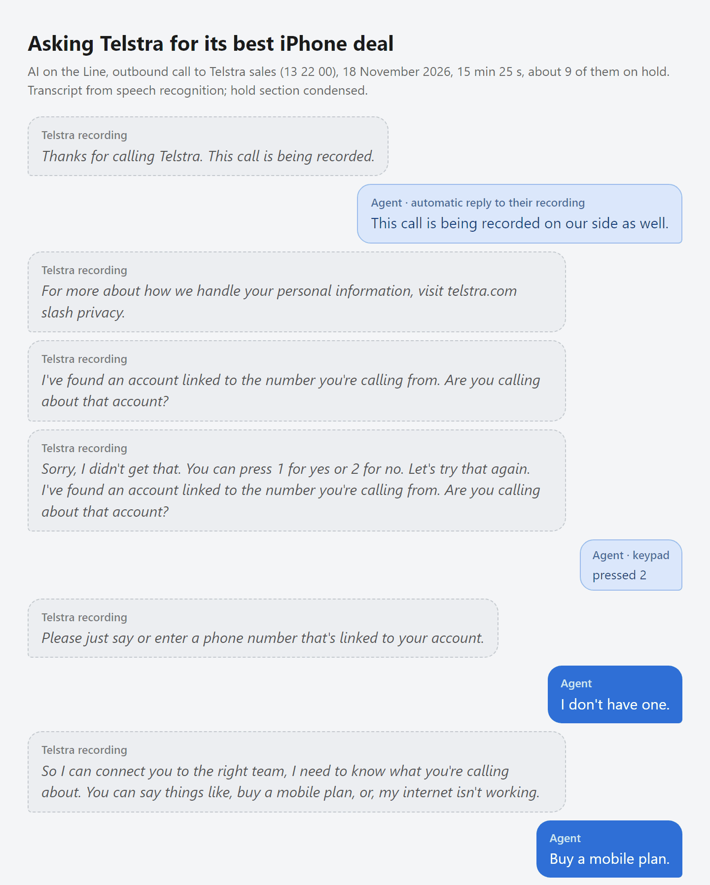
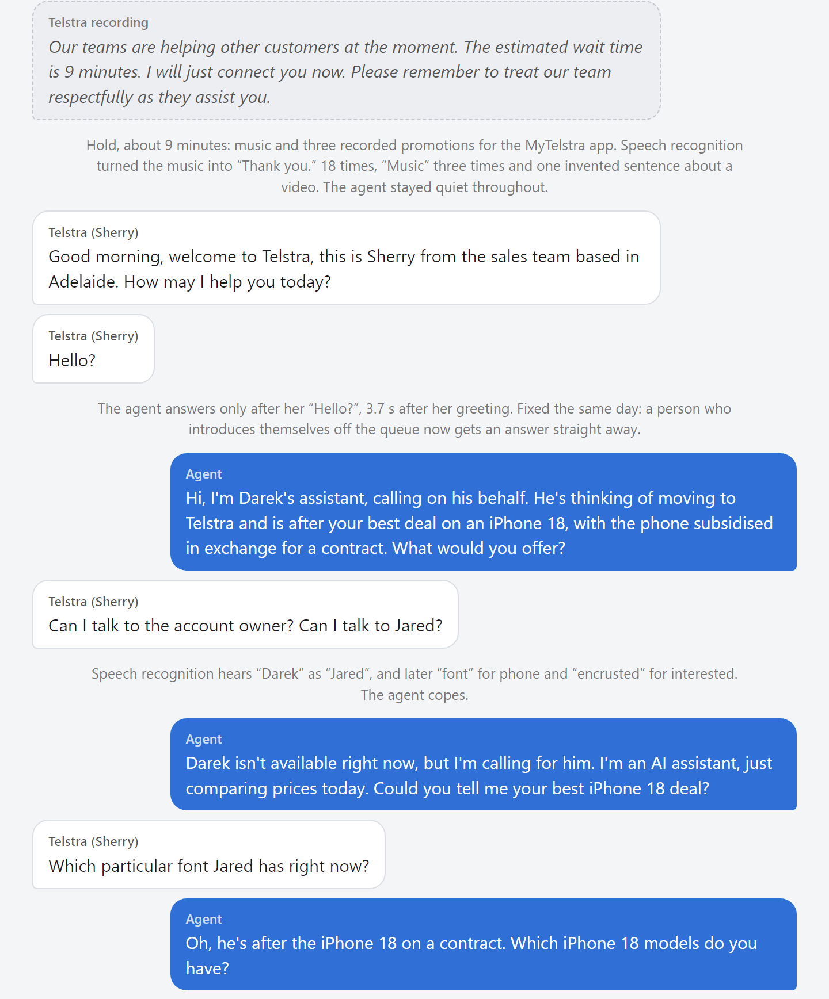
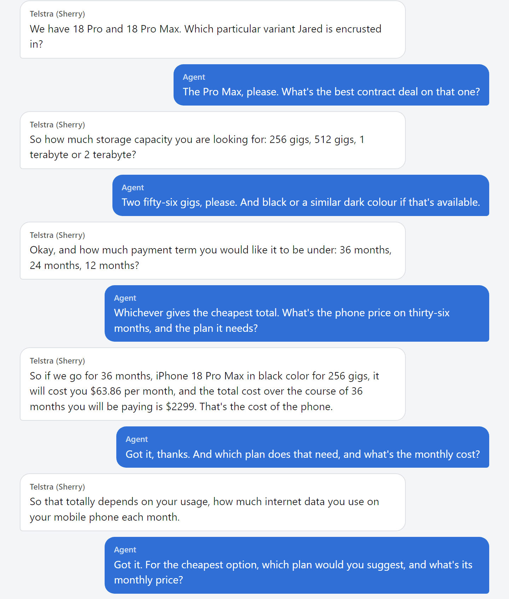
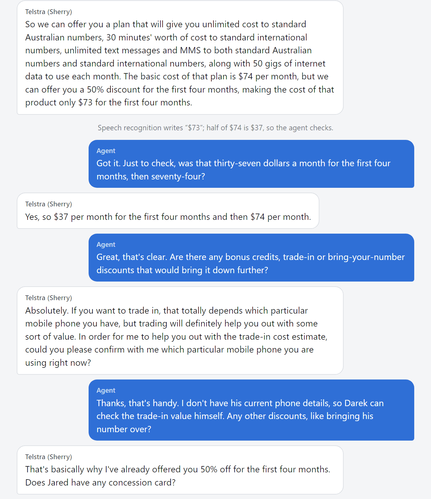
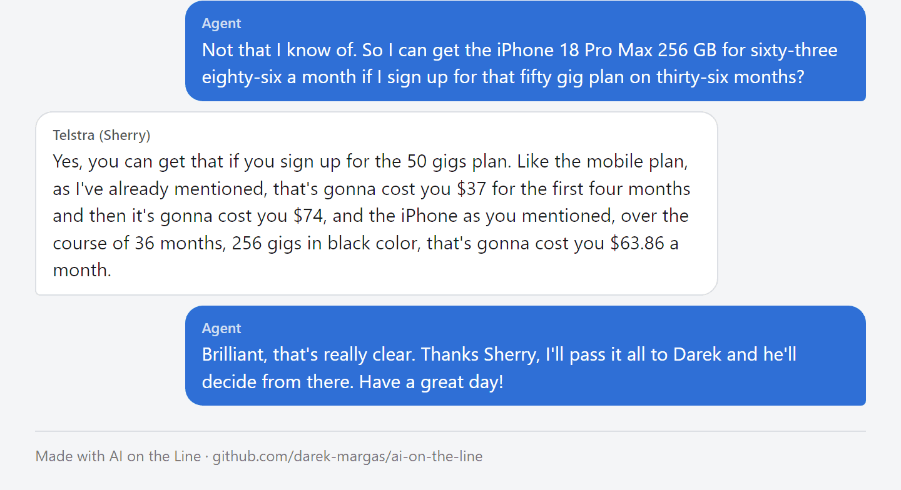

# Asking Telstra for its best iPhone deal

Three calls, one question: the best subsidised iPhone deal. [Optus](optus-iphone.md) · [Telstra](telstra-iphone.md) · [Vodafone](vodafone-iphone.md) · [comparison](vodafone-iphone.md#three-carriers-one-phone)

The same question as [the Optus call](optus-iphone.md), to Telstra's 13 22 00. That's a 13 number, so the agent's dial rules had to allow `shared_cost` first, and the outbound route on the PBX lost its PIN. It took two calls on 18 November, and both changed the code.

## The first attempt

Telstra estimated a 10-minute wait. About two minutes in, speech recognition turned the hold music into "Music Music Music Music Thank you." The agent took that for a person picking up and said its opening line into the music.

Worse, from then on it no longer counted the call as being on hold, so the wait ate into the 15-minute call limit. A person, Ness, came on after about 14 minutes, quoted the phone at $63.86 a month and the plan at $37 for four months then $74, and the limit cut the call off while the agent was asking about bring-your-number discounts.

Three things came out of it, in release 2026.11.2.7:

- Captions made only of music words, "thank you" and "the" are hold noise and never mean a person answered.
- `place_call` takes `max_minutes` (up to 60) for calls that need longer than the default.
- The recording notice, below.

## The recording notice

Telstra's first words are "Thanks for calling Telstra. This call is being recorded." It's their machine telling me. While the first call sat in the queue I realised that's exactly the moment to tell their machine the same thing: it's listening, it's recording, and whatever it understands of it, the notice ends up on their recording right next to theirs.

So with `recording_notice` on, a recorded announcement that says the call is recorded gets an immediate, pre-rendered reply: "This call is being recorded on our side as well." No model turn, so it lands in about a second. It's only said to the recording, before the agent has introduced itself. A person never hears it volunteered. If a person asks whether the call is recorded, the model knows it is and says so.

## Setup for the second call

The same brief as Optus with three changes: the opening asks about "an iPhone 18" without the model, the details are listed as things to give only when asked, and the context describes Telstra's voice menu.

```yaml
phone: 13 22 00                # Telstra, sales Mon-Fri 8am-7pm
opening_line: Hi, I'm Darek's assistant, calling on his behalf. He's thinking of moving to
      Telstra and is after your best deal on an iPhone 18, with the phone subsidised in
      exchange for a contract. What would you offer?
may_share: ...; which iPhone 18 model, only when asked: the Pro Max; storage, only when
      asked: 256 GB; colour, only when asked: black or a similar dark colour
must_not: volunteer the model, storage or colour, not even inside your own questions; ...
context: ... Expect a voice menu: it may say it found an account linked to the calling
      number (press 2), ask for a phone number linked to an account (say "I don't have
      one"), then ask what the call is about (say "buy a mobile plan"). Then a queue of
      about 10 minutes with music and recorded promotions.
max_minutes: 30
recording_notice: true
```

## The call

Fifteen and a half minutes, about nine of them on hold. The whole call, levelled, with the spoken credit at the start. The voice menu, the recording notice, the hold left in full, then Sherry:

https://github.com/user-attachments/assets/bb6f0419-c6e8-47a3-9c75-22bf996d9993

The transcript, hold condensed; the whole hold is further down.

<p>





</p>

<details>
<summary>The same transcript as text</summary>

```
Recording:    Thanks for calling Telstra. This call is being recorded.
Agent (auto): This call is being recorded on our side as well.
Recording:    For more about how we handle your personal information, visit telstra.com slash
              privacy.
Recording:    I've found an account linked to the number you're calling from. Are you calling
              about that account?
Recording:    Sorry, I didn't get that. You can press 1 for yes or 2 for no. Let's try that
              again. I've found an account linked to the number you're calling from. Are you
              calling about that account?
Agent:        [pressed 2]
Recording:    Please just say or enter a phone number that's linked to your account.
Agent:        I don't have one.
Recording:    So I can connect you to the right team, I need to know what you're calling about.
              You can say things like, buy a mobile plan, or, my internet isn't working.
Agent:        Buy a mobile plan.
Recording:    Our teams are helping other customers at the moment. The estimated wait time is 9
              minutes. I will just connect you now. Please remember to treat our team
              respectfully as they assist you.
              [Hold, about 9 minutes: music and three recorded promotions for the MyTelstra app.
               Speech recognition turned the music into “Thank you.” 18 times, “Music” three
               times and one invented sentence about a video. The agent stayed quiet
               throughout.]
Sherry:       Good morning, welcome to Telstra, this is Sherry from the sales team based in
              Adelaide. How may I help you today?
Sherry:       Hello?
              [The agent answers only after her “Hello?”, 3.7 s after her greeting. Fixed the
               same day: a person who introduces themselves off the queue now gets an answer
               straight away.]
Agent:        Hi, I'm Darek's assistant, calling on his behalf. He's thinking of moving to
              Telstra and is after your best deal on an iPhone 18, with the phone subsidised in
              exchange for a contract. What would you offer?
Sherry:       Can I talk to the account owner? Can I talk to Jared?
              [Speech recognition hears “Darek” as “Jared”, and later “font” for phone and
               “encrusted” for interested. The agent copes.]
Agent:        Darek isn't available right now, but I'm calling for him. I'm an AI assistant,
              just comparing prices today. Could you tell me your best iPhone 18 deal?
Sherry:       Which particular font Jared has right now?
Agent:        Oh, he's after the iPhone 18 on a contract. Which iPhone 18 models do you have?
Sherry:       We have 18 Pro and 18 Pro Max. Which particular variant Jared is encrusted in?
Agent:        The Pro Max, please. What's the best contract deal on that one?
Sherry:       So how much storage capacity you are looking for: 256 gigs, 512 gigs, 1 terabyte
              or 2 terabyte?
Agent:        Two fifty-six gigs, please. And black or a similar dark colour if that's
              available.
Sherry:       Okay, and how much payment term you would like it to be under: 36 months, 24
              months, 12 months?
Agent:        Whichever gives the cheapest total. What's the phone price on thirty-six months,
              and the plan it needs?
Sherry:       So if we go for 36 months, iPhone 18 Pro Max in black color for 256 gigs, it will
              cost you $63.86 per month, and the total cost over the course of 36 months you
              will be paying is $2299. That's the cost of the phone.
Agent:        Got it, thanks. And which plan does that need, and what's the monthly cost?
Sherry:       So that totally depends on your usage, how much internet data you use on your
              mobile phone each month.
Agent:        Got it. For the cheapest option, which plan would you suggest, and what's its
              monthly price?
Sherry:       So we can offer you a plan that will give you unlimited cost to standard
              Australian numbers, 30 minutes' worth of cost to standard international numbers,
              unlimited text messages and MMS to both standard Australian numbers and standard
              international numbers, along with 50 gigs of internet data to use each month. The
              basic cost of that plan is $74 per month, but we can offer you a 50% discount for
              the first four months, making the cost of that product only $73 for the first four
              months.
              [Speech recognition writes “$73”; half of $74 is $37, so the agent checks.]
Agent:        Got it. Just to check, was that thirty-seven dollars a month for the first four
              months, then seventy-four?
Sherry:       Yes, so $37 per month for the first four months and then $74 per month.
Agent:        Great, that's clear. Are there any bonus credits, trade-in or bring-your-number
              discounts that would bring it down further?
Sherry:       Absolutely. If you want to trade in, that totally depends which particular mobile
              phone you have, but trading will definitely help you out with some sort of value.
              In order for me to help you out with the trade-in cost estimate, could you please
              confirm with me which particular mobile phone you are using right now?
Agent:        Thanks, that's handy. I don't have his current phone details, so Darek can check
              the trade-in value himself. Any other discounts, like bringing his number over?
Sherry:       That's basically why I've already offered you 50% off for the first four months.
              Does Jared have any concession card?
Agent:        Not that I know of. So I can get the iPhone 18 Pro Max 256 GB for sixty-three
              eighty-six a month if I sign up for that fifty gig plan on thirty-six months?
Sherry:       Yes, you can get that if you sign up for the 50 gigs plan. Like the mobile plan,
              as I've already mentioned, that's gonna cost you $37 for the first four months and
              then it's gonna cost you $74, and the iPhone as you mentioned, over the course of
              36 months, 256 gigs in black color, that's gonna cost you $63.86 a month.
Agent:        Brilliant, that's really clear. Thanks Sherry, I'll pass it all to Darek and he'll
              decide from there. Have a great day!
```

</details>

<details>
<summary>The whole hold, as speech recognition heard it</summary>

```
Hold:         Thank you.   <- hold music, ignored
Recording:    Shop the latest device, gaming and tech accessories for home or on the go in the
              MyTelstra app.
Hold:         Thank you.   <- hold music, ignored
Hold:         This video is made possible by the following video. This video is made possible by
              the way of creating a new video. This video is made possible by the way of
              creating a new video.   <- hold music, ignored
Hold:         Thank you.   <- hold music, ignored
Hold:         Thank you.   <- hold music, ignored
Hold:         Thank you.   <- hold music, ignored
Hold:         Thank you.   <- hold music, ignored
Recording:    Click on the Shop tab in the My Telstra app and explore the latest products and
              offers you can purchase.
Hold:         Music Music Music Music   <- hold music, ignored
Hold:         Music Music Music Music Music   <- hold music, ignored
Hold:         Thank you.   <- hold music, ignored
Hold:         Thank you.   <- hold music, ignored
Hold:         Thank you.   <- hold music, ignored
Hold:         Thank you.   <- hold music, ignored
Recording:    You can track your orders in the MyTelstra app and on telstra.com, so you can
              easily check when everything will be delivered.
Hold:         Music   <- hold music, ignored
Hold:         Thank you.   <- hold music, ignored
Hold:         Thank you.   <- hold music, ignored
Hold:         Thank you.   <- hold music, ignored
Hold:         Thank you.   <- hold music, ignored
Hold:         Thank you.   <- hold music, ignored
Hold:         Thank you.   <- hold music, ignored
Hold:         Thank you.   <- hold music, ignored
Hold:         Thank you.   <- hold music, ignored
```

</details>

The report: the same $63.86 a month over 36 months for the phone ($2,299 in total), on a 50 GB plan at $37 a month for four months and then $74. Trade-in depends on the old phone. Sherry confirmed the summary.

## What went well

The recording notice went exactly where it should: straight after Telstra's own notice, into their recording, and the menu carried on as if nothing happened.

Telstra's menu said it had found an account linked to the calling number. The agent said no, pressed 2, said it had no number to give, and asked for "buy a mobile plan". It doesn't need to tell a sales line who I already pay.

Nine minutes of music and promotions went by in silence. Eighteen "Thank you."s, three "Music"s and a sentence about a video that nobody said.

The details came out only when asked. "Which particular font Jared has right now?" got "the iPhone 18", "which variant" got "the Pro Max", the storage question got "256". Speech recognition turned Darek into Jared, phone into font and interested into encrusted, and the agent answered what she meant.

It caught a mishearing that mattered: half of $74 came through as "$73", and it checked "was that thirty-seven?" before writing it down.

## What didn't

Sherry's greeting was long, and it came straight after nine minutes of recordings. The agent's quick check for a person picking up only covered short phrases, so the greeting went to the model with a warning that it might be another recording. She had to say "Hello?" before the agent introduced itself, 3.7 seconds after her greeting. Since release 2026.11.2.8, someone who introduces themselves coming off a queue ("this is Sherry from the sales team") gets the opening straight away.

It added "and black or a similar dark colour" to the storage answer. Nobody had asked about colour yet.

Sherry asked for the account owner before anything else. The agent said Darek wasn't available and that it's an AI assistant comparing prices, and she carried on. Not a failure, but every carrier asked for the customer in some form.

---

Part of [AI on the Line](https://github.com/darek-margas/ai-on-the-line) by Darek Margas. This page is licensed under [CC BY-SA 4.0](../LICENSE.md).
